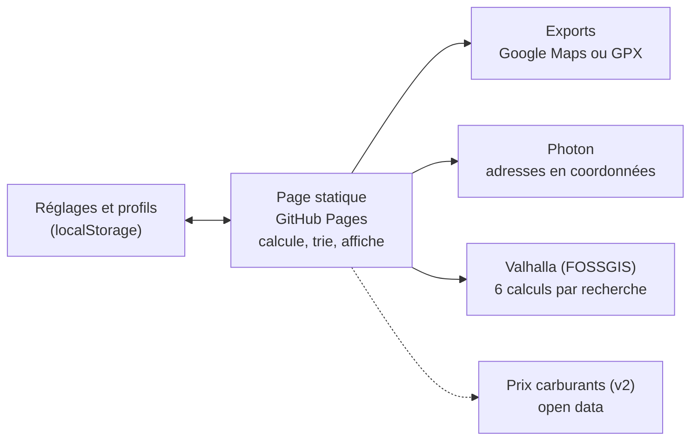

# Radin routier : brief pour Claude Code

25 novembre 2026. Version éditable : le doc « Le vrai prix du trajet : brief pour Claude Code » sur Claude.

## Objectif

Construire une petite appli web qui compare plusieurs itinéraires en voiture et affiche, pour chacun, une ligne : durée et coût réel (carburant, usure, péage). L'appli classe, elle ne choisit pas : l'utilisateur décide en ayant le temps et l'argent sous les yeux.

- **Pourquoi** : Waze et Google Maps optimisent le temps seul. Un détour de 50 km et 15 € de péage pour gagner une minute revient à payer son heure environ 1 400 €.
- **Ce qui manque ailleurs** : ViaMichelin, Mappy ou Roole Map affichent un coût, mais il faut cliquer trajet par trajet, l'usure n'est pas comptée et on ne peut pas trier par prix.
- **Principe de calcul** : le coût marginal. On ne compte que ce qui varie avec les kilomètres et le type de route. Assurance, contrôle technique et révision annuelle sont exclus : ils sont payés quelle que soit la route.
- **Trajets de référence** : Toulouse → Lyon (l'autoroute à péage fait un grand détour par la vallée du Rhône, face à la route directe par Rodez et Le Puy) et Paris → Rouen (A13 payante contre N14 gratuite, presque parallèles). Voiture type : compacte essence 1.2 turbo (SP95-E10, 6 CV) à fort kilométrage.

## Point de départ : le prototype

Un prototype qui fonctionne tient dans un seul fichier, `index.html`, à la racine du dépôt. Il a été testé avec des réponses simulées, mais jamais contre les vrais serveurs : c'est la première chose à vérifier.

- **Adresses** : géocodage avec Photon (premier résultat, recherche orientée vers la France). On peut aussi saisir directement « lat, lon ».
- **Itinéraires** : 6 requêtes Valhalla avec des réglages différents (`use_tolls` 1, 0,5 ou 0 ; `use_highways` 1, 0,4 ou 0 ; `shortest`), avec `alternates` quand c'est possible. Les requêtes partent une par une, à 1,1 s d'intervalle. Deux trajets à moins de 1 % d'écart en distance et en temps comptent comme un seul.
- **Une ligne par trajet** : la durée, le total en euros, les numéros de routes (A81, N157…), le détail carburant, usure et péage, la répartition autoroute, route et ville, et la comparaison avec le plus rapide (« +18 min pour 37 € économisés, soit 122 €/h »).
- **Tri et repères** : tri par temps, par euros ou par compromis ; badges « le plus rapide », « le moins cher » et « meilleur compromis ».
- **Carte** : schéma en SVG des tracés, sans fond de carte. Toucher une ligne met son tracé en évidence.
- **Exports** : un lien Google Maps avec 3 points de passage (à 25, 50 et 75 % du trajet) et un fichier GPX.
- **Réglages** : mémorisés dans le navigateur (localStorage), avec un prix par carburant.

## Modèle de coût

Chaque trajet reçoit deux totaux : les euros dépensés, puis un « compromis » qui ajoute le temps passé, valorisé au prix de l'heure choisi par l'utilisateur.

```math
C = \frac{L_v c_v + L_r c_r + L_a c_a}{100} \, p + L \, u + L_p \, t
```

```math
C_{\text{compromis}} = C + \frac{T}{60} \, h
```

- `L` = distance totale (km), découpée en `L_v` ville, `L_r` route et `L_a` autoroute ; `L_p` = kilomètres à péage.
- `c_v`, `c_r`, `c_a` = consommation en L/100 km selon le type de route ; `p` = prix du litre (€).
- `u` = usure en €/km (voir la section suivante) ; `t` = péage estimé en €/km ; `T` = durée (min) ; `h` = valeur de l'heure (€/h).

Classement des tronçons, à partir des manœuvres Valhalla :

1. Autoroute : le champ `highway` est vrai, ou le nom de route commence par A suivi d'un numéro.
2. Ville : vitesse moyenne de la manœuvre (`length` / `time`) inférieure à 50 km/h.
3. Route : tout le reste.

Les kilomètres à péage sont ceux des manœuvres dont le champ `toll` est vrai. Si le résumé indique un péage (`has_toll`) mais qu'aucune manœuvre n'est marquée, on prend les kilomètres d'autoroute.

Pour chaque trajet, on affiche aussi ce que rapporte l'heure perdue par rapport au plus rapide : (C du plus rapide − C du trajet) ÷ (minutes en plus ÷ 60). Si ce taux dépasse `h`, le détour « paie mieux » que l'heure de l'utilisateur.

## Coût au km d'une compacte essence à fort kilométrage

Valeur retenue : **7 c€/km** d'usure (fourchette 4,5 à 9,5), hors carburant. On n'additionne que les postes qui augmentent avec les kilomètres. Les prix viennent de devis moyens en ligne et d'annonces relevées en 2026.

| Poste | Base de calcul | c€/km |
| --- | --- | --- |
| Pneus | 4 pneus posés, 400 à 560 €, environ 40 000 km ([fiches-auto](https://www.fiches-auto.fr/articles-auto/argent-economie/s-2951-quel-est-le-cout-d-usage-d-une-voiture-pour-100-km-.php), dimensions courantes 195/60 R16 ou 205/50 R17) | 1,2 |
| Freins | Disques et plaquettes avant et arrière, environ 700 € (devis moyens en ligne), environ tous les 80 000 km, plus un jeu de plaquettes entre-temps | 1,0 |
| Embrayage | Kit de 700 à 900 € (devis moyens en ligne), durée de vie de 150 000 à 200 000 km | 0,5 |
| Autres pièces et imprévus | Amortisseurs, batterie, échappement, turbo… Une voiture de 10 ans demande 2,59 c€/km de maintenance selon Audatex ([L'argus](https://www.largus.fr/actualite-automobile/les-vieilles-25-plus-cheres-a-lusage-4891379.html)), révision comprise | 1,5 |
| Décote liée aux km | Compacte d'une dizaine d'années à fort kilométrage : de 5 000 à 7 000 € selon les annonces relevées en 2026. Au-delà de 100 000 km, la perte par km ralentit ([Capcar](https://www.capcar.fr/blog/impact-kilometrage-prix-voiture)) | 2,5 |
| **Total** | Arrondi | **7** |
| Révision, seulement au-delà de 20 000 km/an | 120 à 170 € tous les 20 000 km ou tous les ans (devis moyens en ligne) | +1,0 |

- **La révision** a lieu tous les 20 000 km ou tous les ans, au premier des deux termes atteint. En dessous de 20 000 km par an, c'est l'échéance annuelle qui tombe en premier : c'est alors un coût fixe, exclu du calcul.
- **La décote** est l'estimation la plus fragile. Elle vient de quelques annonces, pas d'une cote officielle.
- **Le barème fiscal** (37,4 c€/km au-delà de 5 000 km pour une 6 CV) inclut l'assurance et la décote d'une voiture moyenne, neuves comprises. Il ne mesure donc pas ce qu'on cherche ici ([economie.gouv.fr](https://www.economie.gouv.fr/particuliers/gerer-mon-impot-sur-le-revenu/impot-sur-le-revenu-tout-savoir-sur-le-bareme-des-frais)).
- **Les vraies factures sont la meilleure source.** L'appli doit permettre de remplacer chaque ligne de ce tableau par ses propres chiffres (section suivante).

## Spécifications fonctionnelles

L'écran tient en une colonne sur téléphone : la saisie, les réglages repliables, puis la liste des trajets. Tout réglage modifié recalcule la liste instantanément, sans relancer les requêtes.

1. **Saisie** : départ et arrivée, avec un bouton pour inverser les deux. Les adresses sont suggérées pendant la frappe (Photon), au lieu de prendre d'office le premier résultat comme le prototype.
2. **Profil véhicule**, mémorisé, avec la possibilité d'en avoir plusieurs : nom, carburant, prix du litre, consommations ville, route et autoroute, usure. Valeurs par défaut : « Compacte essence », SP95-E10, 2,05 €/L, 7,5 / 5,5 / 6,5 L/100 km, 7 c€/km.
3. **Assistant usure** : le tableau de la section précédente, modifiable. Chaque poste a un prix et une durée de vie en km ; la décote se calcule à partir de la valeur actuelle de la voiture et de sa valeur estimée N km plus tard. Une case « plus de 20 000 km par an » ajoute la révision. Le total remplit le champ usure du profil.
4. **Critères** : péage estimé (0,10 €/km par défaut) et valeur de l'heure (15 €/h par défaut).
5. **Liste des trajets**, une carte par trajet :
   - en gros, la durée et le total en euros ;
   - les numéros de routes, le détail carburant, usure et péage, la répartition autoroute, route et ville ;
   - la comparaison avec le plus rapide, en €/h, en vert si elle dépasse la valeur de l'heure ;
   - les badges « le plus rapide », « le moins cher » et « meilleur compromis », à titre indicatif.
6. **Tri** par temps, par euros ou par compromis. Le tri par défaut est à choisir : le prototype trie par compromis.
7. **Carte** : un schéma SVG en première version, un vrai fond de carte ensuite. Toucher un trajet met son tracé en évidence.
8. **Pour partir** : un lien Google Maps avec 3 points de passage et un fichier GPX pour OsmAnd ou Organic Maps. Waze n'accepte pas de points de passage dans un lien, il est donc exclu.
9. **Confort** : des boutons d'au moins 44 px, et un affichage lisible en mode clair comme en mode sombre.

## Architecture technique

Tout tourne dans le navigateur, sans serveur à maintenir.



La page appelle directement Photon et Valhalla depuis le navigateur. Les réglages restent sur le téléphone : il n'y a ni compte, ni base de données, ni serveur à nous.

- **Itinéraires** : Valhalla, moteur libre basé sur OpenStreetMap, via le serveur public FOSSGIS (`https://valhalla1.openstreetmap.de/route?json=…`, en GET pour éviter les requêtes préalables CORS). Champs utilisés : `trip.summary.length` / `time` / `has_toll`, et pour chaque manœuvre `length`, `time`, `toll`, `highway`, `street_names`, plus le tracé `shape` (polyline à 6 décimales). La [référence de l'API](https://valhalla.github.io/valhalla/api/turn-by-turn/api-reference) décrit tous ces champs.
- **Adresses** : Photon (`https://photon.komoot.io/api/?q=…&lang=fr`), recherche orientée vers le centre de la France.
- **Pile technique** : HTML, CSS et JavaScript simples, sans framework. Des tests en Node. Une publication sur GitHub Pages depuis la branche principale.
- **Attribution** obligatoire : « © contributeurs OpenStreetMap », visible dans la page.

## Feuille de route

La v1 consiste à remettre le prototype au propre et à le mettre en ligne. La v2 rend les chiffres plus justes. Il faut finir chaque version avant d'attaquer la suivante.

**v1 : une appli fiable, utilisable sur téléphone**

- [x] Tester le prototype contre les vrais serveurs sur les trajets de référence, et corriger ce qui casse.
- [x] Découper le code en quelques fichiers (`index.html`, `app.js`, `cost.js`, `routing.js`, `styles.css`), sans framework ni étape de compilation.
- [x] Écrire des tests unitaires sous Node, sans dépendance, pour le décodage des tracés, le classement des tronçons, les totaux et la suppression des doublons.
- [x] Ajouter le profil véhicule et l'assistant usure.
- [x] Ajouter les suggestions d'adresses pendant la saisie.
- [ ] Publier sur GitHub Pages.

La v1 est terminée quand, sur téléphone, Toulouse → Lyon affiche au moins 3 trajets différents en moins de 15 secondes, et que chaque total se retrouve à la main à partir de son détail.

**v2 : des chiffres plus justes**

- [ ] Prix du carburant du jour, récupéré dans les données publiques des prix des carburants.
- [ ] Vrais tarifs de péage par tronçon, à la place des 0,10 €/km. La source reste à trouver.
- [ ] Un vrai fond de carte (Leaflet et tuiles OpenStreetMap, en respectant leurs conditions d'utilisation).
- [ ] Appli installable sur l'écran d'accueil (PWA).

**Plus tard, des idées** : des étapes intermédiaires, l'historique des trajets, le trafic en temps réel (aucune source gratuite connue).

## Limites et points à vérifier

Le prototype a été testé contre les vrais serveurs le 25 novembre 2026 : Toulouse → Lyon donne 7 trajets distincts en 10 s, Paris → Rouen 6 trajets en 9 s. Photon et Valhalla renvoient tous deux `Access-Control-Allow-Origin: *`. Reste à confirmer sur téléphone, depuis GitHub Pages.

- **Accès depuis le navigateur** : il faut vérifier que Photon et Valhalla acceptent bien les requêtes venant d'une page publiée sur GitHub Pages (en-têtes CORS).
- **Serveur public Valhalla (FOSSGIS)** : il est gratuit mais partagé. Il faut garder des requêtes espacées et afficher un message clair si le serveur sature. Si ça ne suffit pas, il reste une instance hébergée soi-même ou un service payant basé sur Valhalla.
- **Durées sans trafic** : l'écart de temps entre autoroute et nationale peut changer aux heures de pointe.
- **Péage au kilomètre** : l'estimation peut s'écarter du vrai tarif, surtout sur les tronçons courts et les autoroutes chères. Exemple constaté : le viaduc de Millau (A75) coûte environ 11 € pour quelques kilomètres, alors que l'estimation n'en compte que 6 € sur 59 km.
- **Seuil « ville » à 50 km/h de moyenne** : c'est une approximation, à ajuster après quelques trajets réels.
- **Usure et décote** : ce sont des estimations, à remplacer par les vraies factures.
- **Prix du carburant par défaut** : 2,05 €/L, la moyenne de l'E10 début novembre 2026. Il devient vite faux tant que la v2 ne le récupère pas automatiquement.
- **Lien Google Maps** : Google peut recalculer son propre tracé entre les 3 points de passage.
