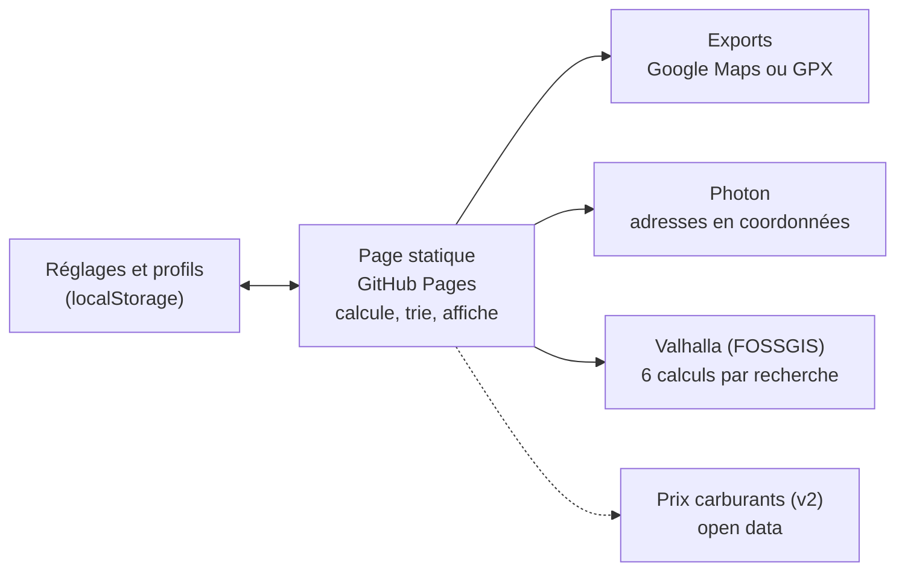

# Radin routier : brief pour Claude Code

25 novembre 2026. Version éditable : le doc « Le vrai prix du trajet : brief pour Claude Code » sur Claude.

## Objectif

Construire une petite appli web qui compare plusieurs itinéraires en voiture et affiche, pour chacun, une ligne : durée et coût réel (carburant, usure, péage). L'appli classe, elle ne choisit pas : l'utilisateur décide en ayant le temps et l'argent sous les yeux.

- **Pourquoi** : Waze et Google Maps optimisent le temps seul. Un détour de 50 km et 15 € de péage pour gagner une minute revient à payer son heure environ 1 400 €.
- **Ce qui manque ailleurs** : ViaMichelin, Mappy ou Roole Map affichent un coût, mais il faut cliquer trajet par trajet, l'usure n'est pas comptée et on ne peut pas trier par prix.
- **Principe de calcul** : le coût marginal. On ne compte que ce qui varie avec les kilomètres et le type de route. Assurance, contrôle technique et révision annuelle sont exclus : ils sont payés quelle que soit la route.
- **Trajets de référence** : Toulouse → Lyon (l'autoroute à péage fait un grand détour par la vallée du Rhône, face à la route directe par Rodez et Le Puy) et Paris → Rouen (A13 payante contre N14 gratuite, presque parallèles). Voiture type : compacte essence 1.2 turbo (SP95-E10, 6 CV) à fort kilométrage.

## Point de départ : le prototype

Un prototype qui fonctionne tient dans un seul fichier, `index.html`, à la racine du dépôt. Il a été testé avec des réponses simulées, mais jamais contre les vrais serveurs : c'est la première chose à vérifier.

- **Adresses** : géocodage avec Photon (premier résultat, recherche orientée vers la France). On peut aussi saisir directement « lat, lon ».
- **Itinéraires** : 6 requêtes Valhalla avec des réglages différents (`use_tolls` 1, 0,5 ou 0 ; `use_highways` 1, 0,4 ou 0 ; `shortest`), avec `alternates` quand c'est possible. Les requêtes partent une par une, à 1,1 s d'intervalle. Deux trajets à moins de 1 % d'écart en distance et en temps comptent comme un seul.
- **Une ligne par trajet** : la durée, le total en euros, les numéros de routes (A81, N157…), le détail carburant, usure et péage, la répartition autoroute, route et ville, et la comparaison avec le plus rapide (« +18 min pour 37 € économisés, soit 122 €/h »).
- **Tri et repères** : tri par temps, par euros ou par compromis ; badges « le plus rapide », « le moins cher » et « meilleur compromis ».
- **Carte** : schéma en SVG des tracés, sans fond de carte. Toucher une ligne met son tracé en évidence.
- **Exports** : un lien Google Maps avec 3 points de passage (à 25, 50 et 75 % du trajet) et un fichier GPX.
- **Réglages** : mémorisés dans le navigateur (localStorage), avec un prix par carburant.

## Modèle de coût

Chaque trajet reçoit deux totaux : les euros dépensés, puis un « compromis » qui ajoute le temps passé, valorisé au prix de l'heure choisi par l'utilisateur.

```math
C = \frac{L_v c_v + L_r c_r + L_a c_a}{100} \, p + L \, u + L_p \, t
```

```math
C_{\text{compromis}} = C + \frac{T}{60} \, h
```

- `L` = distance totale (km), découpée en `L_v` ville, `L_r` route et `L_a` autoroute ; `L_p` = kilomètres à péage.
- `c_v`, `c_r`, `c_a` = consommation en L/100 km selon le type de route ; `p` = prix du litre (€).
- `u` = usure en €/km (voir la section suivante) ; `t` = péage estimé en €/km ; `T` = durée (min) ; `h` = valeur de l'heure (€/h).

Classement des tronçons, à partir des manœuvres Valhalla :

1. Autoroute : le champ `highway` est vrai, ou le nom de route commence par A suivi d'un numéro.
2. Ville : vitesse moyenne de la manœuvre (`length` / `time`) inférieure à 50 km/h.
3. Route : tout le reste.

Les kilomètres à péage sont ceux des manœuvres dont le champ `toll` est vrai. Si le résumé indique un péage (`has_toll`) mais qu'aucune manœuvre n'est marquée, on prend les kilomètres d'autoroute.

Pour chaque trajet, on affiche aussi ce que rapporte l'heure perdue par rapport au plus rapide : (C du plus rapide − C du trajet) ÷ (minutes en plus ÷ 60). Si ce taux dépasse `h`, le détour « paie mieux » que l'heure de l'utilisateur.

## Coût au km d'une compacte essence à fort kilométrage

Valeur retenue : **7 c€/km** d'usure (fourchette 4,5 à 9,5), hors carburant. On n'additionne que les postes qui augmentent avec les kilomètres. Les prix viennent de devis moyens en ligne et d'annonces relevées en 2026.

| Poste | Base de calcul | c€/km |
| --- | --- | --- |
| Pneus | 4 pneus posés, 400 à 560 €, environ 40 000 km ([fiches-auto](https://www.fiches-auto.fr/articles-auto/argent-economie/s-2951-quel-est-le-cout-d-usage-d-une-voiture-pour-100-km-.php), dimensions courantes 195/60 R16 ou 205/50 R17) | 1,2 |
| Freins | Disques et plaquettes avant et arrière, environ 700 € (devis moyens en ligne), environ tous les 80 000 km, plus un jeu de plaquettes entre-temps | 1,0 |
| Embrayage | Kit de 700 à 900 € (devis moyens en ligne), durée de vie de 150 000 à 200 000 km | 0,5 |
| Autres pièces et imprévus | Amortisseurs, batterie, échappement, turbo… Une voiture de 10 ans demande 2,59 c€/km de maintenance selon Audatex ([L'argus](https://www.largus.fr/actualite-automobile/les-vieilles-25-plus-cheres-a-lusage-4891379.html)), révision comprise | 1,5 |
| Décote liée aux km | Compacte d'une dizaine d'années à fort kilométrage : de 5 000 à 7 000 € selon les annonces relevées en 2026. Au-delà de 100 000 km, la perte par km ralentit ([Capcar](https://www.capcar.fr/blog/impact-kilometrage-prix-voiture)) | 2,5 |
| **Total** | Arrondi | **7** |
| Révision, seulement au-delà de 20 000 km/an | 120 à 170 € tous les 20 000 km ou tous les ans (devis moyens en ligne) | +1,0 |

- **La révision** a lieu tous les 20 000 km ou tous les ans, au premier des deux termes atteint. En dessous de 20 000 km par an, c'est l'échéance annuelle qui tombe en premier : c'est alors un coût fixe, exclu du calcul.
- **La décote** est l'estimation la plus fragile. Elle vient de quelques annonces, pas d'une cote officielle.
- **Le barème fiscal** (37,4 c€/km au-delà de 5 000 km pour une 6 CV) inclut l'assurance et la décote d'une voiture moyenne, neuves comprises. Il ne mesure donc pas ce qu'on cherche ici ([economie.gouv.fr](https://www.economie.gouv.fr/particuliers/gerer-mon-impot-sur-le-revenu/impot-sur-le-revenu-tout-savoir-sur-le-bareme-des-frais)).
- **Les vraies factures sont la meilleure source.** L'appli doit permettre de remplacer chaque ligne de ce tableau par ses propres chiffres (section suivante).

## Spécifications fonctionnelles

L'écran tient en une colonne sur téléphone : la saisie, les réglages repliables, puis la liste des trajets. Tout réglage modifié recalcule la liste instantanément, sans relancer les requêtes.

1. **Saisie** : départ et arrivée, avec un bouton pour inverser les deux. Les adresses sont suggérées pendant la frappe (Photon), au lieu de prendre d'office le premier résultat comme le prototype.
2. **Profil véhicule**, mémorisé, avec la possibilité d'en avoir plusieurs : nom, carburant, prix du litre, consommations ville, route et autoroute, usure. Valeurs par défaut : « Compacte essence », SP95-E10, 2,05 €/L, 7,5 / 5,5 / 6,5 L/100 km, 7 c€/km.
3. **Assistant usure** : le tableau de la section précédente, modifiable. Chaque poste a un prix et une durée de vie en km ; la décote se calcule à partir de la valeur actuelle de la voiture et de sa valeur estimée N km plus tard. Une case « plus de 20 000 km par an » ajoute la révision. Le total remplit le champ usure du profil.
4. **Critères** : péage estimé (0,09 €/km par défaut) et **temps en plus accepté** par rapport au trajet le plus rapide (15 min, 30 min, 1 h, 2 h ou « Max » ; 30 min par défaut ; « 0 min » retiré le 27 novembre 2026 : le plus rapide est toujours en tête de liste), choisi par des boutons au-dessus des résultats. « Ton choix » est le trajet le moins cher dans cette limite, variantes comprises, atteint pas à pas depuis le plus rapide : chaque pas doit faire gagner au moins 2 €, quel que soit le prix du trajet, et au moins 1 € toutes les 3 min perdues (20 €/h, gardé en coulisse). « Au-delà » continue de la même façon jusqu'à 2 fois la limite, ou jusqu'à 3 fois s'il fait économiser au moins 20 % de plus. Les marches affichent ce qu'elles rapportent en « 1 € toutes les X min ». (Décision du 25 novembre 2026 : 7 € pour une heure de plus, ce n'est pas acceptable ; radin, mais pas trop.) (Décisions du 25 novembre 2026 : la valeur de l'heure en €/h, fixe puis automatique, n'était pas parlante ; on raisonne en minutes acceptées, comme un humain.)
5. **Liste des trajets**, une carte par trajet :
   - chaque trajet se nomme par sa ville repère la plus distinctive (« par Saumur », `villes.js` nomsTrajets) ; les variantes et les trajets sans intérêt sont rangés sous un seul repli « Autres trajets (N) », et n'apparaissent sur la carte (en pointillés pour les seconds) que s'il est ouvert ;
   - deux rangées et une barre fine, comme Waze : prix, durée, kilomètres et rôle ; puis routes, villes et, pour une variante, son écart (« +1 h 01 · −3 € ») ; toucher la carte ouvre le détail et, pour un autre trajet que ton choix, « Ouvrir dans Maps » (décision du 27 novembre 2026 : maquette B, −24 % de hauteur) ;
   - les numéros de routes ; « Détail du prix » (replié) donne la conso, l'usure (avec les kilomètres) et le péage, avec un petit anneau, puis la répartition autoroute, route et ville et le GPX ;
   - entre deux trajets successifs, une « marche » : « +8 min · −23 € » et ce qu'elle rapporte (« 1 € toutes les 2,6 min »), en vert jusqu'à ton choix, en orange jusqu'à « au-delà », en gris ensuite ;
   - en tête, la synthèse : ton choix, son écart avec le plus rapide et un anneau des dépenses (conso en bleu foncé, usure en bleu clair, péage en jaune, économie en gris ; palette validée pour les daltoniens, montants écrits à côté). Chaque carte porte une barre fine (6 px) des mêmes parts, à la même échelle (le prix du plus rapide) : à kilométrage égal, l'usure a la même longueur, le péage fond et le gris grandit en descendant l'escalier (décisions du 27 novembre 2026 : une seule barre par carte, pas de barre du temps ; des barres prix et temps sur chaque carte faisaient fouillis ; « IK / note de frais » parlait moins que conso, usure et péage, et l'usure est ce que les autres GPS ne comptent pas) ;
   - un seul badge, « Meilleur choix pour toi » : l'escalier montre déjà le plus rapide (en haut) et le moins cher (en bas).
6. **L'escalier** remplace le tri : les trajets utiles sont rangés du plus rapide au moins cher, chaque marche comparant un trajet au précédent. Une marche doit faire économiser au moins 12 % du prix du trajet précédent, ou être une bonne affaire en absolu (au moins 5 €, à au moins 1 € par minute perdue), sinon elle saute ; un trajet presque aussi rapide (moins de 2 min) et moins cher remplace le précédent ; les trajets sautés et ceux qui sont plus lents et plus chers qu'un autre sont repliés sous « autres trajets ». Le rangement complet (escalier, variantes, trajets sans intérêt, choix) est la fonction `classer` de `cost.js`, testée sous Node ; les numéros des trajets ne changent pas d'une pilule à l'autre. (Décision du 25 novembre 2026 : le tri par « compromis » et les €/h n'étaient pas compris.)
7. **Carte** : un schéma SVG en première version, un vrai fond de carte ensuite. Elle reste visible en haut de l'écran pendant qu'on fait défiler la liste. Ton choix est mis en évidence par défaut ; toucher un trajet met son tracé en évidence ; toucher un tracé sélectionne le trajet dans la liste.
   - Chaque trajet indique jusqu'à 3 villes repères traversées (« par Albi · Mende · Saint-Étienne »), espacées d'au moins 25 % du trajet, tirées d'une liste intégrée de 519 préfectures, sous-préfectures et villes de 25 000 habitants et plus (générée par `outils/villes.mjs`).
8. **Raccourcis** : la voiture (menu) et le mode pro (bouton « Pro · péage remboursé ») restent visibles au-dessus de « Comparer », puis au-dessus de la carte avec les résultats ; les changer recalcule aussitôt les trajets déjà trouvés.
9. **Partager** : un bouton à côté de « Ouvrir dans Maps » partage un lien `…/radin_routier/?de=…&a=…&temps=…` (menu de partage du téléphone, sinon copie). Ouvert, ce lien remplit le trajet ; la recherche part sur « Comparer », le temps de vérifier les raccourcis (voiture, mode pro) ; « Ma position » y devient des coordonnées arrondies à 100 m environ.
10. **Pour partir** : un lien Google Maps avec 3 points de passage placés là où le trajet s'écarte du plus rapide (entrée, milieu et sortie du détour, `mixtes.js` pointsDePassage), pour que le GPS ne reprenne pas l'autoroute ; et un fichier GPX pour OsmAnd ou Organic Maps. Waze n'accepte pas de points de passage dans un lien, il est donc exclu.
11. **Confort** : des boutons d'au moins 44 px, et un affichage lisible en mode clair comme en mode sombre.

## Architecture technique

Tout tourne dans le navigateur, sans serveur à maintenir.



La page appelle directement Photon et Valhalla depuis le navigateur. Les réglages restent sur le téléphone : il n'y a ni compte, ni base de données, ni serveur à nous.

- **Itinéraires** : Valhalla, moteur libre basé sur OpenStreetMap, via le serveur public FOSSGIS (`https://valhalla1.openstreetmap.de/route?json=…`, en GET pour éviter les requêtes préalables CORS). Champs utilisés : `trip.summary.length` / `time` / `has_toll`, et pour chaque manœuvre `length`, `time`, `toll`, `highway`, `street_names`, plus le tracé `shape` (polyline à 6 décimales). La [référence de l'API](https://valhalla.github.io/valhalla/api/turn-by-turn/api-reference) décrit tous ces champs.
- **Adresses** : Photon (`https://photon.komoot.io/api/?q=…&lang=fr`), recherche orientée vers le centre de la France.
- **Pile technique** : HTML, CSS et JavaScript simples, sans framework. Des tests en Node. Une publication sur GitHub Pages depuis la branche principale.
- **Attribution** obligatoire : « © contributeurs OpenStreetMap », visible dans la page.

## Feuille de route

La v1 consiste à remettre le prototype au propre et à le mettre en ligne. La v2 rend les chiffres plus justes. Il faut finir chaque version avant d'attaquer la suivante.

**v1 : une appli fiable, utilisable sur téléphone**

- [x] Tester le prototype contre les vrais serveurs sur les trajets de référence, et corriger ce qui casse.
- [x] Découper le code en quelques fichiers (`index.html`, `app.js`, `cost.js`, `routing.js`, `styles.css`), sans framework ni étape de compilation.
- [x] Écrire des tests unitaires sous Node, sans dépendance, pour le décodage des tracés, le classement des tronçons, les totaux et la suppression des doublons.
- [x] Ajouter le profil véhicule et l'assistant usure.
- [x] Ajouter les suggestions d'adresses pendant la saisie.
- [ ] Publier sur GitHub Pages.

La v1 est terminée quand, sur téléphone, Toulouse → Lyon affiche au moins 3 trajets différents en moins de 15 secondes, et que chaque total se retrouve à la main à partir de son détail.

**v1.2 : trajets mixtes (fait)**

- [x] Après les 6 calculs, repérer les endroits où un trajet sans autoroute rejoint (ou quitte) un trajet par autoroute, et calculer « sans autoroute jusque-là, puis autoroute » (et l'inverse) : 4 points au plus, 8 requêtes, environ 10 s de plus. Le point de bascule sert d'étape au lien Google Maps.

**v1.6 : découpage par villes étapes (fait)**

- [x] Après les trajets mixtes, choisir 2 grandes villes (50 000 habitants et plus) traversées entre 30 et 80 % d'un trajet trouvé, espacées de 50 km. Pour chacune : variantes du premier morceau (rapide avec variantes, péage modéré), puis le plus rapide jusqu'à l'arrivée. 6 requêtes, environ 7 s. Sur un long trajet, le serveur ignore des variantes qu'il propose sur un morceau plus court.

**v1.7 : profils en plus et exploration approfondie (fait)**

- [x] Banc d'essai sur 2 trajets (environ 140 requêtes) de 4 générateurs : entrées et sorties d'autoroute, double bascule, 5 villes étapes avec variantes des deux côtés, profils supplémentaires. Seuls les profils (péage faible, autoroute modérée) ont ajouté un trajet utile : ils rejoignent la recherche normale (10 profils, environ 35 s).
- [x] Les trois autres générateurs forment un bouton « Explorer encore » (environ 55 calculs, 1 min 30), avec progression, bouton Arrêter et nouveaux trajets marqués 🆕. Chaque morceau de trajet n'est calculé qu'une fois et resservi dans toutes les combinaisons.

**v2 : des chiffres plus justes**

- [x] Prix du carburant du jour (`carburant.js`) : moyenne des stations à moins de 30 km du départ ayant mis leur prix à jour depuis moins de 7 jours (flux « Prix des carburants en France », data.economie.gouv.fr), sinon moyenne nationale ; case « Prix du jour » cochée par défaut, le prix manuel reste mémorisé.
- [x] Ponts et tunnels à péage à leur prix réel (`ouvrages.js`, tarifs 2026, à mettre à jour chaque 1er février) : viaduc de Millau (tarif d'été), ponts de Normandie, de Tancarville et de l'île de Ré (payant vers l'île), tunnels du Mont-Blanc, du Fréjus, Maurice-Lemaire, du Puymorens, Prado-Carénage, Duplex A86. Un ouvrage remplace le prix au kilomètre du tronçon payant qui le contient : Valhalla marque parfois tout un axe comme payant (329 km d'A75 pour le seul viaduc de Millau).
- [x] Tarif réel au kilomètre de 40 autoroutes (`outils/peages.mjs`, à relancer chaque année) : APRR et AREA à partir des grilles entrée-sortie de data.gouv.fr (avec distance tarifaire) ; ASF, Escota et Cofiroute à partir des tarifs internes publiés en texte par VINCI Autoroutes, la distance étant estimée à vol d'oiseau entre les gares (coordonnées data.gouv.fr) × un facteur de détour de 1,12 mesuré sur APRR. Autoroute peu mesurée : médiane de sa société. L'A75 reste gratuite (seul le viaduc est payant). Sanef et SAPN (A1, A2, A4, A13, A14, A16, A29) : grilles PDF difficiles à lire automatiquement, estimation à la main sur de longs trajets (environ 0,10 €/km, 0,54 €/km pour l'A14), affichée « tarif estimé ».
- [ ] Script annuel avec une clé de service de péage, lancé à la main, qui génère une base de tarifs (sans clé dans la page).
- [x] Un vrai fond de carte : Leaflet 1.9.4 copié dans `vendor/leaflet/` (licence BSD-2, pas de CDN), tuiles OpenStreetMap passées en gris (filtre CSS ; anthracite en mode sombre) pour que la couleur reste aux tracés ; CARTO, plus sobre, a été écarté : il exige désormais une clé nominative qui serait publique dans le dépôt ; la carte se recadre quand de nouveaux trajets élargissent la zone, pas à chaque sélection.
- [x] Appli installable sur l'écran d'accueil (PWA) : manifeste, icônes (dont une « maskable » pour Android), service worker minimal sans cache (il ne sert qu'à l'installation : hors ligne, l'appli ne peut rien calculer ; message « Pas de connexion » clair), bouton « Installer l'appli » quand le navigateur le propose.

- [x] Voiture électrique, en prototype (27 novembre 2026) : carburant « Électrique (essai) », prix du kWh saisi (pas de flux officiel du jour), conso en kWh/100 km (15 en ville, 14 sur route, 19 sur autoroute par défaut) ; même modèle de coût.

**Plus tard, des idées** : des étapes intermédiaires, l'historique des trajets, le trafic en temps réel (aucune source gratuite connue), « ton trajet habituel » repéré d'une recherche à l'autre, l'heure d'arrivée, un bouton aller-retour, une exigence qui suit la pilule (« patience » : 1 € toutes les 2 min avec 15 min, toutes les 8 min sans limite ; à décider sur un trajet où la pilule ne change rien), un mode pro complet (IK au barème). Fait : l'interrupteur « Péage remboursé (déplacement pro) » retire le péage des prix et du classement, en le laissant dans le détail, et affiche ta marge : note de frais (IK au barème, 0,665 €/km par défaut, soit 6 CV, sur la distance du trajet le plus rapide, plus le péage) moins le coût réel (`cost.js` margePro).

## Limites et points à vérifier

Le prototype a été testé contre les vrais serveurs le 25 novembre 2026 : Toulouse → Lyon donne 7 trajets distincts en 10 s, Paris → Rouen 6 trajets en 9 s. Photon et Valhalla renvoient tous deux `Access-Control-Allow-Origin: *`. Reste à confirmer sur téléphone, depuis GitHub Pages.

- **Accès depuis le navigateur** : il faut vérifier que Photon et Valhalla acceptent bien les requêtes venant d'une page publiée sur GitHub Pages (en-têtes CORS).
- **Serveur public Valhalla (FOSSGIS)** : il est gratuit mais partagé. Il faut garder des requêtes espacées et afficher un message clair si le serveur sature. Si ça ne suffit pas, il reste une instance hébergée soi-même ou un service payant basé sur Valhalla.
- **Durées sans trafic** : l'écart de temps entre autoroute et nationale peut changer aux heures de pointe.
- **Temps corrigés** (`cost.js` K_ROUTE = 0,75, K_VILLE = 1,10) : Valhalla est trop lent sur la route ouverte (N20 : 2 h 16 contre 1 h 39 chez Waze) et un peu trop rapide dans les traversées de villes et de villages ; sur autoroute, il tombe juste. Calé sur 20 comparaisons avec Waze et Google Maps en circulation normale, mêmes départs et arrivées (plaine, voies express, départementales, villages, Massif central, Alpes). Validation croisée (erreur sur un trajet laissé hors du calage) : 8,7 % d'écart moyen, contre 9,9 % avec un coefficient unique et 12,3 % sans correction. Les écarts restants (jusqu'à ±20 %) tiennent surtout au trafic du moment chez Google.
- **Péage au kilomètre** : l'estimation peut s'écarter du vrai tarif, surtout sur les tronçons courts et les autoroutes chères. Exemple constaté : le viaduc de Millau (A75) coûte environ 11 € pour quelques kilomètres, alors que l'estimation n'en compte que 6 € sur 59 km.
- **Seuil « ville » à 50 km/h de moyenne** : c'est une approximation, à ajuster après quelques trajets réels.
- **Usure et décote** : ce sont des estimations, à remplacer par les vraies factures.
- **Prix du carburant** : moyenne des stations (prix du jour) ; 2,05 €/L seulement si le service est injoignable. La moyenne locale peut s'écarter du prix de la station où l'on fait réellement le plein.
- **Lien Google Maps** : Google peut recalculer son propre tracé entre les 3 points de passage.
